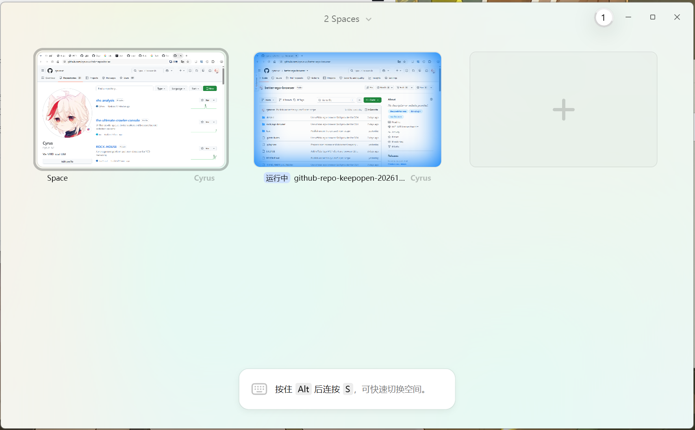

# The DSH plugin closest to the native ego lite experience on Windows

[简体中文](README.md) | **English**

**better-ego-browser** · Windows desktop · Community maintained · Connects to [official ego lite](https://lite.ego.app/)

## Use the official browser you are already signed into

- 🔐 **No need to import your logins again.** Keep using the profiles and website sessions in official ego lite. Switching to DSH does not mean moving your cookies to another browser.
- 🪟 **Your actual Windows desktop app.** Personal spaces and DSH task spaces appear in the familiar ego lite window. No separate `ego-linux` browser instance is needed.
- ✅ **Browser operations without privilege escalation.** DSH connects over authenticated loopback HTTP, so each browser interaction does not require switching the shell to Full Access.
- ⚡ **Keep ego-browser's lightning-fast browsing and interaction.** Navigation, semantic snapshots, clicks, form filling, and screenshots run through official ego-browser. Describe your goal and get started, just as you would with its native Codex or Claude Code integration.

Built for the official Windows desktop version of ego lite. macOS and Linux are not currently supported.

## Demo



The image shows the Spaces overview in official ego lite for Windows. Repository page screenshots are captured by DSH calling `ego_loopback_browser`: **create an isolated space → open this repository → take a screenshot**.

## How it compares

| Project | Browser backend | DSH integration | Advantages |
| --- | --- | --- | --- |
| **🚀 better-ego-browser** | The official ego lite app installed on Windows | Authenticated loopback HTTP → official CLI on the host | ✅ No login import; ✅ no privilege escalation for browser operations; ✅ the same official app, login environment, and task-space experience as native integration |
| [Fisfzy/dsh-ego-browser](https://github.com/Fisfzy/dsh-ego-browser/tree/feb87d60d8fc16349a0373de5209b6f35032b741) | Bundled `ego-linux` port connected to Chrome/Chromium | Node runtime and structured tools | ⚠️ Separate profile: logins must be prepared or imported for that environment; does not use the installed official Windows ego lite app |
| [Da1dr1em/dsh-ego-browser](https://github.com/Da1dr1em/dsh-ego-browser/tree/25ab028307072e2745fbab3764b234aa893a71c5) | `ego-windows-host` bridge backed by Edge/Chrome | Host-side CLI with scripts passed over stdin/stdout pipes | ⚠️ Requires an additional bridge host and a separate profile; uses CDP port 9522 by default |
| [Official DSH Skill adapter](https://github.com/citrolabs/ego-lite/blob/bacaece43900e8ca68eea3b6f1663835ea38df9e/plugins/ego/dsh/src/index.js) | Official ego lite | A Skill instructs the model to run CLI commands | ⚠️ Connecting directly to the CLI bootstrap from a Windows sandbox may require additional permissions |

**Keep using the official app, without an extra browser-environment migration.** Website session expiry and authorization requirements are still handled by the official app and the websites themselves.

## Installation

Install [official ego lite for Windows](https://lite.ego.app/), complete its initial setup, and sign into the websites you need in the appropriate profile. Requires DSH `0.2.0-rc.1` or later, Node.js 22 or later, and an available Windows desktop environment.

### Install from source

```bash
git clone https://github.com/cyrus-xc/better-ego-browser.git
cd better-ego-browser
dsh plugin --profile desktop add "file:$(node -p 'process.cwd()')"
```

After installing through the CLI, make sure the profile's `package.json` includes `@cyrusxc5/better-ego-browser` in `dsh.profile.bundles`, alongside your other plugins. Replace `desktop` with your profile name if needed.

Restart DSH and start a new conversation to use `/ego-browser`.

### Install from npm

📦 The npm package is not available yet. Once published, add and enable **`@cyrusxc5/better-ego-browser`** in DSH's plugin manager, or run:

```bash
dsh plugin --profile desktop add @cyrusxc5/better-ego-browser
```

## Usage

**Open a page, read it, and take a screenshot:**

```text
/ego-browser Open https://github.com/cyrus-xc/better-ego-browser, read the repository description, and take a screenshot. Finish the task space when done.
```

**Search and fill forms:**

```text
/ego-browser Open the website I specify, find its search box, enter my keywords, and click Search. Summarize the results and finish the task.
```

**Inspect existing spaces:**

```text
/ego-browser Show the current browser spaces and recent tab titles without taking over my personal space.
```

No manual HTTP address, port, or authentication token configuration is needed. Screenshots are returned in the conversation and saved under `~/Desktop/ego-loopback-artifacts`. Keep the ego lite window unminimized when taking screenshots.

## Available operations

| What you want to do | Operation |
| --- | --- |
| View browser spaces and recent tab titles | `spaces` |
| Open pages and read semantic snapshots | `navigate`, `snapshot` |
| Click and fill forms | `click`, `fill` |
| Capture page screenshots | `screenshot` |
| Create and finish isolated task spaces | `create`, `finish` |
| Check the browser connection | `health` |

Each browsing goal uses one isolated space, which is finished on success. Operations stop if the user takes control or an error occurs, leaving the space available for follow-up.

`spaces` returns space summaries and recent titles, not a complete list of tabs or URLs. Arbitrary host JavaScript, raw CDP, uploads, and downloads are not exposed. The everyday browsing experience and the full CLI's API coverage are distinct.

<details>
<summary>🔧 Connection architecture</summary>

```text
DSH /ego-browser
  → ego_loopback_browser
  → random 127.0.0.1 port + Bearer authentication
  → official ego-browser CLI on the plugin host
  → official ego lite for Windows
```

Loopback handles communication between DSH and the host broker. Native IPC between the official CLI and the browser remains part of the official implementation. Browser calls do not require broader DSH shell permissions; permission rules for other DSH tools stay unchanged.

</details>

This project is community maintained and [MIT licensed](LICENSE). The official browser and CLI are installed and updated separately. See [UPSTREAM.json](UPSTREAM.json) and [THIRD_PARTY_LICENSE.txt](THIRD_PARTY_LICENSE.txt) for upstream resource attribution and licensing.
