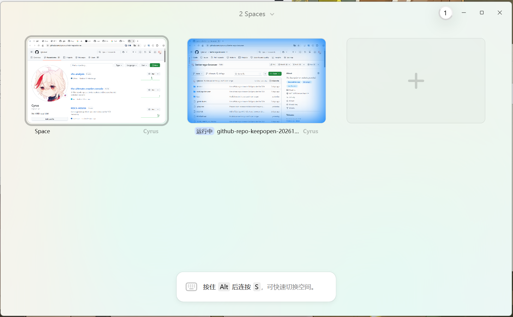

# Windows端最还原官方ego-lite使用体验的DSH插件

**简体中文** | [English](README.en.md)

**better-ego-browser** · Windows 桌面版 · 社区维护 · 连接 [官方 ego lite](https://lite.ego.app/)

## 直接用上你已经登录的官方浏览器

- 🔐 **无需重新导入登录态。** 继续使用官方 ego lite 中已有的 profile 和网站登录环境，切换到 DSH 不用再搬一次 Cookie。
- 🪟 **就是本机安装的官方应用。** 用户空间和 DSH 任务空间都显示在熟悉的 ego lite 窗口中，无需另起一个 `ego-linux` 实例。
- ✅ **浏览器操作无需提权。** DSH 通过带认证的本机 loopback HTTP 调用浏览器，不需要为每一轮操作把 shell 切换到完整访问模式。
- ⚡ **保留 ego-browser 闪电般的浏览与操作体验。** 导航、语义快照、点击、填写、截图都交给官方 ego-browser。像使用 Codex、Claude Code 的原生接入一样，描述目标就能开始。

面向 Windows 官方 ego lite 桌面版；macOS、Linux 暂未适配。

## 演示



图中是官方 Windows ego lite 的空间总览。仓库页面截图由 DSH 调用 `ego_loopback_browser` 获取：**创建独立空间 → 打开本仓库 → 截图**。

## 与其他实现的区别

| 方案 | 浏览器后端 | DSH 接入方式 | 优势 |
| --- | --- | --- | --- |
| **🚀 better-ego-browser** | 本机安装的官方 Windows ego lite | 带认证的 loopback HTTP → 宿主侧官方 CLI | ✅ 无需重新导入登录态；✅ 浏览器操作无需提权；✅ 官方应用、登录环境与任务空间的体验和原生接入一致 |
| [Fisfzy/dsh-ego-browser](https://github.com/Fisfzy/dsh-ego-browser/tree/feb87d60d8fc16349a0373de5209b6f35032b741) | 内置 `ego-linux` 移植 runtime，连接 Chrome/Chromium | Node runtime 与结构化工具 | ⚠️ 独立 profile，需要为这套环境准备登录态或做导入；不是本机官方 Windows ego lite 应用 |
| [Da1dr1em/dsh-ego-browser](https://github.com/Da1dr1em/dsh-ego-browser/tree/25ab028307072e2745fbab3764b234aa893a71c5) | `ego-windows-host` 桥接宿主，后端 Edge/Chrome | 宿主侧 CLI，stdin/stdout 管道传递脚本 | ⚠️ 需要额外准备桥接宿主及独立 profile；默认使用 CDP 端口 9522 |
| [官方 DSH Skill 适配器](https://github.com/citrolabs/ego-lite/blob/bacaece43900e8ca68eea3b6f1663835ea38df9e/plugins/ego/dsh/src/index.js) | 官方 ego lite | Skill 引导模型执行 CLI 命令 | ⚠️ Windows 沙箱中直接连接 CLI bootstrap 可能需要额外权限 |

**直接继续使用官方应用，不需要额外完成这次环境迁移。** 网站本身的登录有效期和授权要求仍由官方应用与网站处理。

## 安装

先安装 [官方 Windows ego lite](https://lite.ego.app/)，完成首次启动，并在需要使用的 profile 中登录网站。需要 DSH `0.2.0-rc.1` 或更新版本、Node.js 22 或更新版本，以及可用的 Windows 桌面环境。

### 从源码安装

```bash
git clone https://github.com/cyrus-xc/better-ego-browser.git
cd better-ego-browser
dsh plugin --profile desktop add "file:$(node -p 'process.cwd()')"
```

CLI 安装后，确认该 profile 的 `package.json` 中，`dsh.profile.bundles` 列表包含 `@cyrusxc5/better-ego-browser`，并保留其他插件条目。`desktop` 可替换为你使用的 profile 名。

重启 DSH，开启新会话，即可使用 `/ego-browser`。

### 通过 npm 安装

📦 npm 包暂未上架。上架后，可在 DSH 插件管理界面输入 **`@cyrusxc5/better-ego-browser`** 添加并启用，也可以使用：

```bash
dsh plugin --profile desktop add @cyrusxc5/better-ego-browser
```

## 使用

**打开网页、阅读并截图：**

```text
/ego-browser 打开 https://github.com/cyrus-xc/better-ego-browser，读取仓库说明并截图，完成后结束本次任务空间。
```

**搜索与填写：**

```text
/ego-browser 打开我指定的网站，找到搜索框，输入关键词并点击搜索，整理结果后结束任务。
```

**查看已有空间：**

```text
/ego-browser 看看现在有哪些浏览器空间和近期标签标题，不接管我的用户空间。
```

无需手工配置 HTTP 地址、端口或认证 token。截图直接返回对话，并保存在 `~/Desktop/ego-loopback-artifacts`。截图时保持 ego lite 窗口非最小化即可。

## 能做什么

| 你要做的事 | 对应操作 |
| --- | --- |
| 查看浏览器空间与近期标签标题 | `spaces` |
| 打开页面、读取语义快照 | `navigate`、`snapshot` |
| 点击与填写表单 | `click`、`fill` |
| 获取页面截图 | `screenshot` |
| 创建、结束独立任务空间 | `create`、`finish` |
| 检查浏览器连接 | `health` |

一个浏览目标使用一个独立空间，成功后结束。用户接管或出现错误时停止操作，保留空间供后续处理。

`spaces` 提供空间摘要与近期标题，不是完整标签页或全部 URL 清单。任意宿主 JavaScript、原始 CDP、文件上传与下载暂未开放；日常浏览体验与完整 CLI 的 API 覆盖范围需区分。

<details>
<summary>🔧 连接方式</summary>

```text
DSH /ego-browser
  → ego_loopback_browser
  → 127.0.0.1 随机端口 + Bearer 认证
  → 插件宿主侧的官方 ego-browser CLI
  → 官方 Windows ego lite
```

loopback 负责 DSH 到宿主代理的通信，官方 CLI 与浏览器之间的原生 IPC 仍由官方实现完成。浏览器调用无需放宽 DSH shell 的权限；DSH 其他工具的权限规则保持原样。

</details>

本项目由社区维护，采用 [MIT 许可](LICENSE)。官方浏览器与 CLI 独立安装、独立更新；上游资源的来源和许可见 [UPSTREAM.json](UPSTREAM.json) 与 [THIRD_PARTY_LICENSE.txt](THIRD_PARTY_LICENSE.txt)。
